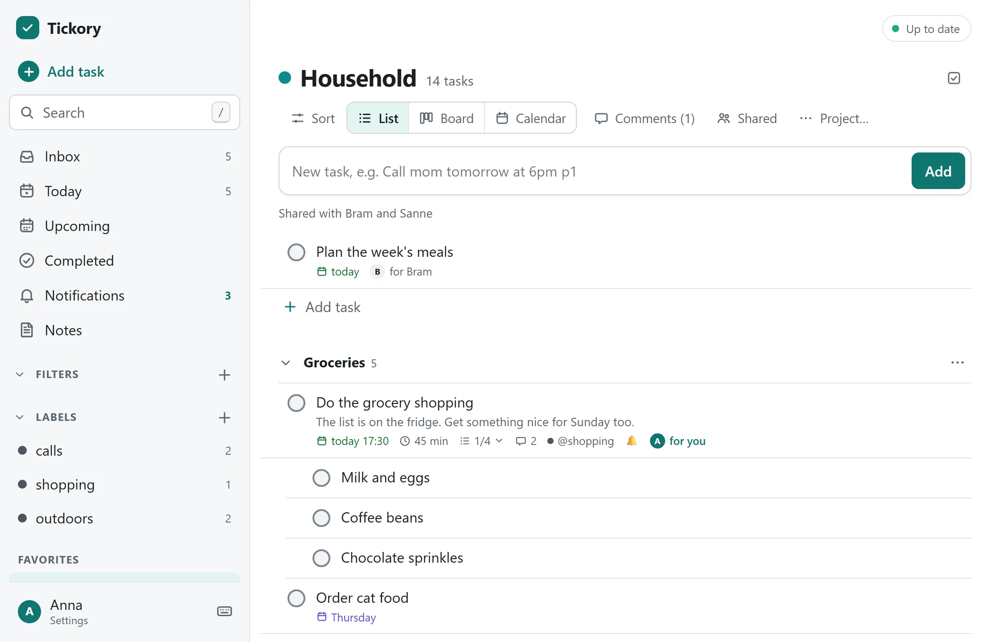

<p align="center">
  
</p>
<h1 align="center">Tickory</h1>
<p align="center">
  The to-do list and notes app you host yourself: for you, your family or a small team.<br>
  <a href="https://wnijhof.github.io/tickory/en/">Website</a> ·
  <a href="https://wnijhof.github.io/tickory/demo/?lang=en">Demo</a> ·
  <a href="https://wnijhof.github.io/tickory/en/guide/">Guide</a> ·
  <a href="README.nl.md">Nederlands</a>
</p>

Tickory is a self-hosted, offline-first task and notes app: a sync server and an installable web app in a single Docker container, plus an Android app and a browser extension. Your data stays on your own server. No npm packages and no build step: Node 26 runs the TypeScript directly and SQLite is part of Node.

<picture>
  <source media="(prefers-color-scheme: dark)" srcset="website/assets/shots/project-dark.webp">
  
</picture>

## Features

- **Tasks:** projects, sections, subtasks, labels, priorities, deadlines, durations, comments, attachments, Markdown.
- **Quick add** in plain Dutch: `Tandarts bellen morgen om 9 uur #Thuis @bellen p1 !30m`, recurrences like "elke tweede dinsdag".
- **Views:** list, board and calendar; Today, Upcoming, sorting and grouping, Completed, productivity.
- **Notes**, like Google Keep and Anchor: formatting, checklists, colours, labels, pictures and audio, reminders, version history, sharing, import from Keep and Markdown.
- **Together:** shared projects (can edit or view only), assigning, @-mentions, notifications, activity log.
- **Reminders:** in the browser (Web Push) and as alarms in the Android app, also at a place.
- **Search, filters, templates, undo, selecting several tasks, keyboard shortcuts.**
- **Offline** on several devices at once; changes from others arrive within seconds.
- **Apps:** installable web app (PWA), Android app with widgets, browser extension.
- **Accounts:** multiple users, two-step verification, SSO (OpenID Connect), backups from the app.
- **Import** from Todoist (backup zip or CSV) and Google Keep; export as CSV or JSON.
- **Languages:** English and Dutch interface; dates are typed in Dutch for now.

## Try it

The [demo](https://wnijhof.github.io/tickory/demo/?lang=en) is the real app with sample data, running in your browser: no server, no account, nothing is saved (and no notifications).

## Quick start with Docker

```sh
git clone https://github.com/WNijhof/tickory.git && cd tickory
cp .env.example .env      # set TODO_ADMIN_USER and TODO_ADMIN_PASSWORD (at least 10 characters)
docker compose up -d      # http://127.0.0.1:8787
```

The first account is an administrator; you create the other accounts in the app. Remove the password from `.env` afterwards and run `docker compose up -d --force-recreate`. Put HTTPS in front (Tailscale, Caddy, Cloudflare Tunnel) for offline use, installing as an app and notifications on your phone. Images exist for `amd64` and `arm64`.

Updating: `docker compose pull && docker compose up -d`.

## Documentation

The [guide](https://wnijhof.github.io/tickory/en/guide/) covers everything in English and Dutch:

- **Using it:** [adding tasks](https://wnijhof.github.io/tickory/en/guide/adding-tasks.html), [dates and recurrences](https://wnijhof.github.io/tickory/en/guide/dates-and-recurrence.html), [notes](https://wnijhof.github.io/tickory/en/guide/notes.html), [reminders](https://wnijhof.github.io/tickory/en/guide/reminders.html), [sharing](https://wnijhof.github.io/tickory/en/guide/sharing.html), [the Android app](https://wnijhof.github.io/tickory/en/guide/android-app.html), [switching from Todoist](https://wnijhof.github.io/tickory/en/guide/switching-from-todoist.html).
- **Running a server:** [installing](https://wnijhof.github.io/tickory/en/guide/installing.html), [HTTPS](https://wnijhof.github.io/tickory/en/guide/https.html), [managing users](https://wnijhof.github.io/tickory/en/guide/managing-users.html), [SSO](https://wnijhof.github.io/tickory/en/guide/sign-in-with-sso.html), [attachments](https://wnijhof.github.io/tickory/en/guide/attachments.html), [updating](https://wnijhof.github.io/tickory/en/guide/updating.html), [backup and restore](https://wnijhof.github.io/tickory/en/guide/backup.html), [troubleshooting](https://wnijhof.github.io/tickory/en/guide/troubleshooting.html).
- **For developers:** the protocol and data model in [SPEC.md](SPEC.md) (in Dutch), the Android app in [android/README.md](android/README.md), the extension in [extension/README.md](extension/README.md). All settings are in [.env.example](.env.example).

## Status

Version 0.4. The server and web app are well tested. The Android app (APK on the [releases page](https://github.com/WNijhof/tickory/releases)) and reminders at a place have been tested on a computer and a simulated Android, not yet on a real phone. The browser extension is not in the stores yet. English date phrases ("tomorrow") are not recognised yet.

## Development

Requires Node 26.

```sh
TODO_ADMIN_USER=anna TODO_ADMIN_PASSWORD='a-good-password' node server/main.ts   # http://127.0.0.1:8787 (Windows: start.cmd)
npm test                  # unit and integration tests
npm run e2e               # the whole app in a real browser (Edge or Chrome, headless)
npm run site:check        # the website and the demo
```

See [CONTRIBUTING.md](CONTRIBUTING.md) for the ground rules (zero dependencies, Dutch first, tests that can really fail) and [SECURITY.md](SECURITY.md) to report a vulnerability.

## License

Free software under the [GNU Affero General Public License, version 3](LICENSE) (AGPL-3.0). The bundled date parser falls under the MIT license of chrono-node, see [THIRD_PARTY_NOTICES.md](THIRD_PARTY_NOTICES.md).
