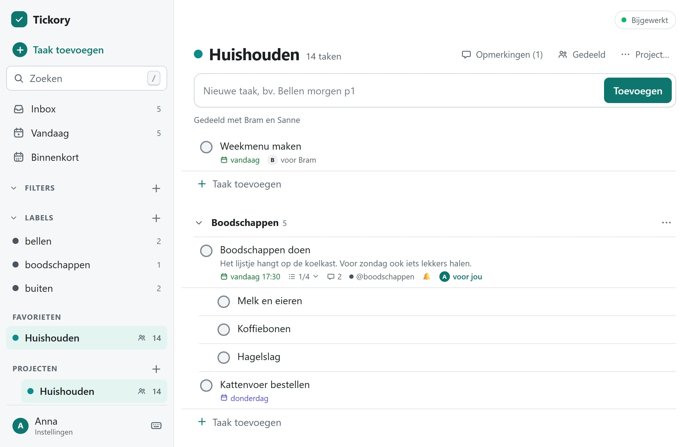

<p align="center">
  
</p>
<h1 align="center">Tickory</h1>
<p align="center">
  The to-do list you host yourself: for you, your family or a small team.<br>
  <a href="https://wnijhof.github.io/tickory/en/">Website</a> ·
  <a href="https://wnijhof.github.io/tickory/demo/?lang=en">Demo</a> ·
  <a href="https://wnijhof.github.io/tickory/en/guide/">Guide</a> ·
  <a href="README.nl.md">Nederlands</a>
</p>

Tickory is a self-hosted, offline-first to-do app: a sync server and an installable web app (PWA) in a single Docker container. Multiple users, shared projects, task assignment, and dates and recurrences typed in plain language. Your data stays on your own server.

No npm packages and no build step: Node 26 runs the TypeScript directly and SQLite is part of Node. That keeps the image small and leaves almost nothing to maintain.

<picture>
  <source media="(prefers-color-scheme: dark)" srcset="website/assets/shots/project-dark.webp">
  
</picture>

> **The app is in Dutch for now.** The interface, the messages and the date language (`morgen om 9 uur`, `elke tweede dinsdag`) are Dutch. An English interface is in development; English date language comes after that. The [guide](https://wnijhof.github.io/tickory/en/guide/) is available in English and explains the Dutch labels.

## Try it

The [demo](https://wnijhof.github.io/tickory/demo/?lang=en) is the real app with sample data, running entirely in your browser: no server, no account, nothing is saved. To run the same demo locally:

```sh
node scripts/build-site.ts && node scripts/serve-site.ts     # http://127.0.0.1:8798/tickory/demo/
```

## Quick start with Docker

You need Docker with `docker compose`. The image exists for `amd64` (ordinary PC, mini PC, NAS) and `arm64` (Raspberry Pi with a 64-bit system; 32-bit is not supported).

```sh
git clone https://github.com/WNijhof/tickory.git
cd tickory
cp .env.example .env
```

1. **First account.** Put the username and password (at least 10 characters) of the first account in `.env`: `TODO_ADMIN_USER` and `TODO_ADMIN_PASSWORD`. That account is created on the very first start and is an **administrator**: you use it to create the other accounts in the app. Never commit `.env` (it is already in `.gitignore`). After the first start you can remove the password from `.env`; it is no longer used.
2. **Image.** `docker-compose.yml` pulls `ghcr.io/wnijhof/tickory:latest`. Would you rather build on the server yourself? Remove the `image:` line and put `build: .` back.
3. **Start.**

   ```sh
   docker compose up -d
   docker compose ps          # after a few seconds: (healthy)
   docker compose logs -f
   ```

By default the container is only reachable from the server itself (`127.0.0.1:8787`); it is meant to sit behind **HTTPS**, see below. If you only want to use it on your home network without HTTPS (then only desktop browsers work fully, see the note under HTTPS), change the port line to `"8787:8787"` and open `http://<ip-of-the-server>:8787`.

Open the app and sign in with the first account.

While the repository or the image is still private, the server has to sign in once to pull: `docker login ghcr.io -u <your-github-name>` with a token that only has `read:packages`.

## What it does

- Multiple accounts, each with their own Inbox; an administrator creates accounts and resets passwords.
- Sharing a project with other users of the same server, and assigning tasks to members.
- Tasks with subtasks, projects, sections, labels, priorities P1 to P4, date and time, deadlines.
- Dates and recurrences in plain Dutch, including "every second Tuesday of the month" and Dutch holidays.
- Quick add on one line: `#project`, `/section`, `@label`, `p1` to `p4`, `{deadline}` and a date.
- The views Vandaag (today, with overdue tasks) and Binnenkort (the next two weeks).
- Ticking off with undo; showing or hiding completed tasks.
- Working offline with sync, on several devices at once, with changes from others arriving within seconds.
- Installable as an app (PWA) on phone and computer.
- Managing your password and the devices you are signed in on.

## Status

Version 0.2: multiple users and shared projects. The core works and is tested; many features of apps such as Todoist are still missing.

**In development (not finished):**

- **Reminders with a notification.** The server can store and sync reminders, but the app has no screen for them yet and **no notification is sent anywhere**.
- **An Android app (APK).** Until it exists, use the web app in your phone's browser.
- **An English interface.** The app is Dutch only for now.

**Stored on the server, but the app has no screen or button for it yet** (so you cannot use it):

- **Comments** on tasks and projects.
- **Filters** (saved searches): there is no filter language and no screen.
- Sub-projects, favourites, **archiving** projects and sections, the **duration** of a task, and a board or calendar view.

**Missing entirely:**

- **Dragging or otherwise changing the order of tasks.** A new task always goes to the end.
- **Search.**
- **Managing labels** (renaming, deleting, filtering by label).
- Attachments, statistics, templates, import and export, an iCal feed, keyboard shortcuts, widgets, a custom order for Vandaag, inviting by link or e-mail, and transferring ownership of a project.

What gets added, and in which order, is up to the owner of the repository. See also chapter 10 of [SPEC.md](SPEC.md) (in Dutch).

## Documentation

The [guide](https://wnijhof.github.io/tickory/en/guide/) on the website covers everything below in more detail, in English and Dutch:

- For users: [adding tasks](https://wnijhof.github.io/tickory/en/guide/adding-tasks.html), [dates and recurrences](https://wnijhof.github.io/tickory/en/guide/dates-and-recurrence.html), [projects](https://wnijhof.github.io/tickory/en/guide/projects.html), [sharing](https://wnijhof.github.io/tickory/en/guide/sharing.html), [offline](https://wnijhof.github.io/tickory/en/guide/offline.html), [install as an app](https://wnijhof.github.io/tickory/en/guide/install-as-app.html), [account](https://wnijhof.github.io/tickory/en/guide/account.html).
- For administrators: [installing](https://wnijhof.github.io/tickory/en/guide/installing.html), [managing users](https://wnijhof.github.io/tickory/en/guide/managing-users.html), [HTTPS](https://wnijhof.github.io/tickory/en/guide/https.html), [updating](https://wnijhof.github.io/tickory/en/guide/updating.html), [backup and restore](https://wnijhof.github.io/tickory/en/guide/backup.html), [troubleshooting](https://wnijhof.github.io/tickory/en/guide/troubleshooting.html).

The protocol and data model are described in [SPEC.md](SPEC.md) (in Dutch). It is an original design, built on the findings of an earlier study of how Todoist works (not part of this repository).

## Running a server

### Accounts and users

- **In the app:** Instellingen (settings), "Account, wachtwoord en apparaten". There you change your password and see which devices you are signed in on (and sign one out). Administrators also find "Gebruikersbeheer" (user management) there: creating and blocking accounts, making someone an administrator and resetting passwords.
- **From the server**, for example when you have lost your password:

  ```sh
  docker compose exec tickory node server/main.ts user list
  docker compose exec -e TODO_PASSWORD='a-good-password' tickory node server/main.ts user add anna --name "Anna de Vries"
  docker compose exec -it tickory node server/main.ts user passwd anna        # asks for the password, hidden
  docker compose exec tickory node server/main.ts user disable anna           # or: enable, logout-all
  ```

  `--admin` after `user add` creates an administrator. Without `TODO_PASSWORD` and without a terminal (`-it`) no password can be asked for.
- There is no open sign-up and no password reset by e-mail: an administrator creates accounts and resets passwords. There is always at least one active administrator.
- Every device gets its own session when signing in, which you can revoke. After eight failed attempts within fifteen minutes on one account (or forty from one address), signing in is refused until those fifteen minutes have passed.
- An administrator manages accounts, not other people's tasks: an administrator, too, only sees the projects they are a member of.

### Sharing and working together

- Open a project, choose **Delen** (share), and type the username of someone else on this server. That person sees the project with everything in it (including what was already there), and everyone works in the same tasks and sections. Whoever created the project is the **owner**; the others are **members**.
- The owner can share, remove people, and move or delete the project. A member can work in the project and leave it ("Project verlaten"). An owner cannot leave without deleting the project.
- Tasks can be **assigned** to a member ("voor Bob"). When someone leaves or is removed, the assignment lapses.
- Your **Inbox** is yours alone and cannot be shared.
- **Personal:** reminders, filters and labels. Labels that someone else puts on a task in a shared project are visible to you (as `@label`), but you cannot rename or delete them.
- Sub-projects of a shared project are shared along with it. If you delete a project, a sub-project you do not own stays, at the top level. (The server supports sub-projects; the app has no button to create them yet.)
- Known limitation: the **order in the sidebar** and the favourite mark belong to the project and are therefore not per person.

### HTTPS (needed for your phone)

Browsers only allow **offline use** (service worker) and **installing as an app** over HTTPS; only `localhost` is an exception. So without HTTPS the app does work in your phone's browser, but not offline and not as an installed app. Choose what fits your network:

- **Tailscale** (the simplest, nothing public): install Tailscale on the server and the phone, enable HTTPS in your tailnet and run `tailscale serve --bg 8787` on the server. You get an `https://…ts.net` address that only your own devices can reach.
- **Reverse proxy with your own domain** (Caddy, Traefik, Nginx Proxy Manager): point the proxy at `127.0.0.1:8787` and let it handle the certificate. With Caddy this is the whole configuration:

  ```
  tasks.example.org {
      reverse_proxy 127.0.0.1:8787
  }
  ```

  Also set `TRUST_PROXY=1` in `.env`, so that the visitor's address (and not that of the proxy) counts when limiting sign-in attempts. **Only** switch this on when there really is a proxy in front: otherwise a visitor can supply their own address.
- **Cloudflare Tunnel**: useful when you do not want to open ports.

Do not put the app on the open internet without HTTPS: the password and the session would travel unencrypted.

### Updating

When the maintainer tags a new version (see below), GitHub builds a new image. On the server:

```sh
docker compose pull && docker compose up -d
```

Your data is in a Docker volume and is kept. If you build yourself: `git pull && docker compose up -d --build --pull always`. Note: a new version of the underlying Node image (security updates) only comes in when a new image is built.

### Upgrading from version 0.1

Version 0.1 had one token for one person. Put `TODO_ADMIN_USER` and `TODO_ADMIN_PASSWORD` in `.env` (you can remove `TODO_TOKEN`) and start the new version. On the first start that account is created and **takes over all existing data** (projects, labels, filters, reminders), including your Inbox. After that you have to sign in again on every device. Make a backup first (see below).

### Backup and restore

The database is a single SQLite file in the volume. Make a consistent copy while the app is running:

```sh
docker compose exec -T tickory node server/backup.ts /data/backups/todo-$(date +%F).db
```

This never overwrites an existing copy. The copies are stored in the volume itself; regularly get them off the server as well, for example with `docker cp tickory:/data/backups ./backups`, and schedule the command with `cron`. You clean up old copies yourself. **A copy contains all tasks of all users, the password hashes and the (hashed) sessions**: keep it the way you keep the database itself.

Restoring a copy (the app has to be stopped; replace `backup.db` with your file):

```sh
docker compose down
docker run --rm -v tickory_tickory-data:/data -v "$PWD":/backup alpine sh -c \
  "rm -f /data/todo.db-wal /data/todo.db-shm && cp /backup/backup.db /data/todo.db && chown 1000:1000 /data/todo.db"
docker compose up -d
```

The volume name starts with the name of the directory in which you run `docker compose` (here `tickory`); check it with `docker volume ls`. **After that, sign out and in again on every device** (Instellingen, "Afmelden en lokale gegevens wissen"). A device that knew newer changes than the backup only notices the restored file by itself as long as the server has not yet grown past its state; signing in again is the sure way and costs nothing, because everything is on the server.

### Private repository or image

While the repository or the image is private (the beginning), your server has to sign in once to be able to pull and clone:

```sh
docker login ghcr.io -u <your-github-name>     # password: a token with only "read:packages"
```

To fetch without signing in, make the repository and the package public (they contain no secrets; passwords and accounts are only in your own `.env` and database). The package is switched on GitHub: your profile, Packages, `tickory`, Package settings, Change visibility.

## Quick add and Dutch dates

Type one line in the input field; below the field you see what was recognised.

```
Tandarts bellen morgen om 9 uur #Thuis /Keuken @bellen p1
Oud papier elke tweede dinsdag
Verjaardag Jan elk jaar op 5 december
Cadeau kopen voor Sinterklaas
Belasting regelen eind januari
Hardlopen elke ochtend om 7 uur
Aangifte doen {31-12} !!2
~Mei bellen          (the ~ switches date recognition off for the whole line)
```

`#project`, `/section` (within that project), `@label` (unknown labels are created), `p1` to `p4` or `!!1` to `!!4` (1 is the highest), `{deadline}`, and a date or recurrence in plain language. All supported forms, with examples that are checked against the parser, are in the guide: [dates and recurrences](https://wnijhof.github.io/tickory/en/guide/dates-and-recurrence.html). The full Dutch description is in [README.nl.md](README.nl.md#nederlands).

## Running locally without Docker

Requires Node 26. Handy for trying it out or for development.

```sh
TODO_ADMIN_USER=anna TODO_ADMIN_PASSWORD='a-good-password' node server/main.ts      # bash; http://127.0.0.1:8787
```

On Windows: double-click `start.cmd`, or run `.\start.cmd` in PowerShell. The first time it asks for a username and a password (typed hidden) for the first account, and then the server starts; the Windows script policy stays unchanged (see `start.cmd`).

Environment variables: `TODO_ADMIN_USER`, `TODO_ADMIN_PASSWORD` and `TODO_ADMIN_NAME` (only on the very first start), `PORT` (8787), `HOST` (127.0.0.1; in Docker 0.0.0.0), `DB_PATH` (`./data/todo.db`; in Docker `/data/todo.db`), `TRUST_PROXY` (`1` behind your own reverse proxy), `CORS_ORIGIN` (optional, one exact origin).

## Tests

```sh
npm test            # protocol, permissions, accounts, server, client, date language, views, backup, offline files
npm run e2e         # the whole app in a real browser (Edge or Chrome, headless), 22 steps
node scripts/docker-smoke.ts tickory:ci    # test of the image (needs Docker, after: docker build -t tickory:ci .)
node scripts/build-site.ts && node scripts/site-check.ts    # the website and the demo (needs Edge or Chrome)
```

The tests include a property test for the order keys and a **differential test**: hundreds of random actions are executed both optimistically in the client and by the real server engine, and both must end up in exactly the same state. For multiple users there are separate tests of who may see and do what (two real clients on one server), and the access rules were checked with deliberately broken code: every broken rule must make a test fail. They pass in every time zone. The browser test saves screenshots in `.e2e/shots/`.

## Layout

```
shared/    orderKey.js, recurrence.js, schema.js, text.js   shared by server and client
server/    schema.ts, rows.ts, sync.ts, users.ts, main.ts, backup.ts
           tables, rows, sync engine with permissions, accounts and sessions, HTTP + SSE + files, backup
client/    index.html, app.css, sw.js, manifest             the web app
client/core/   reducer, store, idb, syncClient, events, actions, auth, backend, dateNl, quickadd, selectors, format, messages
client/ui/     app, render, taskDialog, shareDialog, accountDialogs, dom
client/vendor/ nlDatum.generated.js                         Dutch date parser (with chrono-node, see THIRD_PARTY_NOTICES.md)
website/       pages (nl, en), assets, layout.html, site.json, demo/   the website, the guide and the demo backend
scripts/       e2e.ts, docker-smoke.ts, smoke.ts, make-icons.js, start.ps1,
               build-site.ts, serve-site.ts, site-check.ts, site-shots.ts, site-browser.ts
```

## The website

The website (home page, guide and demo) is plain HTML, CSS and JavaScript in `website/`, built without dependencies:

```sh
node scripts/build-site.ts      # builds _site/: the pages, and demo/ with the app and an in-browser backend
node scripts/serve-site.ts      # serves it on http://127.0.0.1:8798/tickory/, the same path as on GitHub Pages
node scripts/site-check.ts      # checks links, the date examples in the guide, and the demo in a headless browser
node scripts/site-shots.ts      # regenerates the screenshots and the social preview from the demo
node scripts/make-icons.js      # regenerates the PNG icons from the same geometry as client/icon.svg
```

The workflow `Website` (`.github/workflows/pages.yml`) builds, checks and publishes it to GitHub Pages on every push to `main`.

## Publishing a new version (maintainer)

```sh
git tag v0.2.0 && git push origin v0.2.0
```

The workflow `Image publiceren` runs the tests, builds the image, **starts it with the security settings from `docker-compose.yml` and checks its behaviour** (healthy, correct user, only `/data` writable, the first account and a second account, separated data, data survives a restart, clean shutdown, backup works), and then publishes `ghcr.io/WNijhof/tickory` with the tags `0.2.0`, `0.2` and `latest`. If a single check fails, nothing is published.

## Contributing and security

See [CONTRIBUTING.md](CONTRIBUTING.md) for how to test and what the ground rules are (zero dependencies, Dutch first, tests that can really fail). Report vulnerabilities privately; see [SECURITY.md](SECURITY.md).

## License

Tickory is free software under the [GNU Affero General Public License, version 3](LICENSE) (AGPL-3.0). You may use, modify and distribute it; if you offer a modified version to others as a service, you must make its source code available. The bundled date parser falls under the MIT license of chrono-node, see [THIRD_PARTY_NOTICES.md](THIRD_PARTY_NOTICES.md).
