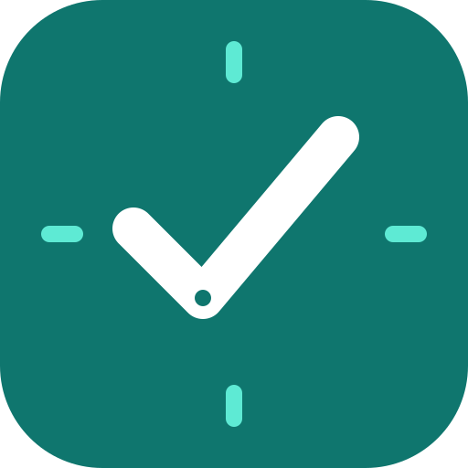
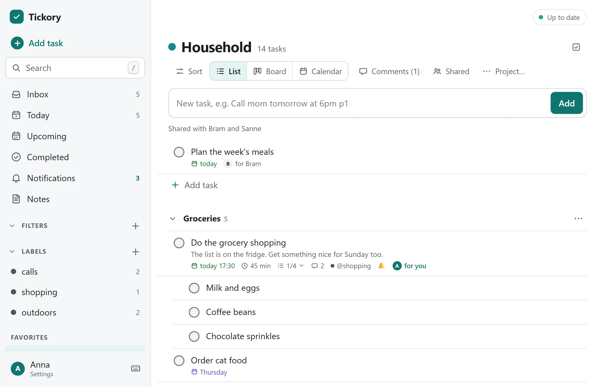

<p align="center">
  
</p>
<h1 align="center">Tickory</h1>
<p align="center">
  De takenlijst en notitie-app die je zelf host: voor jezelf, je gezin of een klein team.<br>
  <a href="https://wnijhof.github.io/tickory/nl/">Website</a> ·
  <a href="https://wnijhof.github.io/tickory/demo/?lang=nl">Demo</a> ·
  <a href="https://wnijhof.github.io/tickory/nl/handleiding/">Handleiding</a> ·
  <a href="README.md">English</a>
</p>

Tickory is een zelf te hosten, offline-first app voor taken en notities: een sync-server en een installeerbare web-app in één Docker-container, plus een Android-app en een browserextensie. Je gegevens blijven op je eigen server. Geen npm-pakketten en geen build-stap: Node 26 voert de TypeScript zelf uit en SQLite zit in Node.

<picture>
  <source media="(prefers-color-scheme: dark)" srcset="website/assets/shots/project-dark.webp">
  
</picture>

## Wat het kan

- **Taken:** projecten, secties, subtaken, labels, prioriteiten, deadlines, duur, opmerkingen, bijlagen, Markdown.
- **Snel toevoegen** in gewoon Nederlands: `Tandarts bellen morgen om 9 uur #Thuis @bellen p1 !30m`, herhalingen als "elke tweede dinsdag", feestdagen.
- **Weergaven:** lijst, bord en kalender; Vandaag, Aankomend, sorteren en groeperen, Voltooid, productiviteit.
- **Notities**, zoals Google Keep en Anchor: opmaak, checklists, kleuren, labels, foto's en geluid, herinneringen, versiegeschiedenis, delen, importeren uit Keep en Markdown.
- **Samen:** gedeelde projecten (bewerken of alleen lezen), toewijzen, @-vermeldingen, meldingen, activiteitenlogboek.
- **Herinneringen:** in de browser (Web Push) en als alarm in de Android-app, ook op een plek.
- **Zoeken, filters, sjablonen, ongedaan maken, meerdere taken tegelijk, sneltoetsen.**
- **Offline** op meerdere apparaten tegelijk; wijzigingen van anderen zijn er binnen seconden.
- **Apps:** installeerbare web-app (PWA), Android-app met widgets, browserextensie.
- **Accounts:** meerdere gebruikers, tweestapsverificatie, SSO (OpenID Connect), back-ups vanuit de app.
- **Importeren** uit Todoist (back-up-zip of CSV) en Google Keep; exporteren als CSV of JSON.
- **Talen:** Nederlands en Engels; datums typ je voorlopig in het Nederlands.

## Proberen

De [demo](https://wnijhof.github.io/tickory/demo/?lang=nl) is de echte app met voorbeeldgegevens, helemaal in je browser: geen server, geen account, er wordt niets bewaard (en geen meldingen).

## Snel starten met Docker

```sh
git clone https://github.com/WNijhof/tickory.git && cd tickory
cp .env.example .env      # vul TODO_ADMIN_USER en TODO_ADMIN_PASSWORD in (minstens 10 tekens)
docker compose up -d      # http://127.0.0.1:8787
```

Het eerste account is beheerder; de andere accounts maak je in de app. Haal daarna het wachtwoord uit `.env` en draai `docker compose up -d --force-recreate`. Zet HTTPS ervoor (Tailscale, Caddy, Cloudflare Tunnel) voor offline gebruik, installeren als app en meldingen op je telefoon. Er zijn images voor `amd64` en `arm64`.

Bijwerken: `docker compose pull && docker compose up -d`.

## Documentatie

De [handleiding](https://wnijhof.github.io/tickory/nl/handleiding/) beschrijft alles, in het Nederlands en het Engels:

- **Gebruiken:** [taken toevoegen](https://wnijhof.github.io/tickory/nl/handleiding/taken-toevoegen.html), [datums en herhalingen](https://wnijhof.github.io/tickory/nl/handleiding/datums-en-herhalingen.html), [notities](https://wnijhof.github.io/tickory/nl/handleiding/notities.html), [herinneringen](https://wnijhof.github.io/tickory/nl/handleiding/herinneringen.html), [delen](https://wnijhof.github.io/tickory/nl/handleiding/delen.html), [de Android-app](https://wnijhof.github.io/tickory/nl/handleiding/android-app.html), [overstappen van Todoist](https://wnijhof.github.io/tickory/nl/handleiding/overstappen-van-todoist.html).
- **Een server draaien:** [installeren](https://wnijhof.github.io/tickory/nl/handleiding/installeren.html), [HTTPS](https://wnijhof.github.io/tickory/nl/handleiding/https.html), [gebruikers beheren](https://wnijhof.github.io/tickory/nl/handleiding/gebruikers-beheren.html), [SSO](https://wnijhof.github.io/tickory/nl/handleiding/inloggen-met-sso.html), [bijlagen](https://wnijhof.github.io/tickory/nl/handleiding/bijlagen.html), [bijwerken](https://wnijhof.github.io/tickory/nl/handleiding/bijwerken.html), [back-up en terugzetten](https://wnijhof.github.io/tickory/nl/handleiding/back-up.html), [problemen oplossen](https://wnijhof.github.io/tickory/nl/handleiding/problemen-oplossen.html).
- **Voor ontwikkelaars:** het protocol en datamodel in [SPEC.md](SPEC.md), de Android-app in [android/README.md](android/README.md), de extensie in [extension/README.md](extension/README.md). Alle instellingen staan in [.env.example](.env.example).

## Stand van zaken

Versie 0.3. De server en de web-app zijn goed getest. De Android-app (APK op de [releasepagina](https://github.com/WNijhof/tickory/releases)) en herinneringen op een plek zijn getest op een computer en een nagebootste Android, nog niet op een echte telefoon. De browserextensie staat nog niet in de winkels. Engelse datumzinnen ("tomorrow") worden nog niet herkend.

## Ontwikkelen

Vraagt Node 26.

```sh
TODO_ADMIN_USER=anna TODO_ADMIN_PASSWORD='een-goed-wachtwoord' node server/main.ts   # http://127.0.0.1:8787 (Windows: start.cmd)
npm test                  # unit- en integratietests
npm run e2e               # de hele app in een echte browser (Edge of Chrome, zonder venster)
npm run site:check        # de website en de demo
```

Zie [CONTRIBUTING.md](CONTRIBUTING.md) voor de spelregels (geen afhankelijkheden, Nederlands eerst, tests die echt kunnen falen) en [SECURITY.md](SECURITY.md) om een kwetsbaarheid te melden.

## Licentie

Vrije software onder de [GNU Affero General Public License, versie 3](LICENSE) (AGPL-3.0). De meegeleverde datumherkenning valt onder de MIT-licentie van chrono-node, zie [THIRD_PARTY_NOTICES.md](THIRD_PARTY_NOTICES.md).
