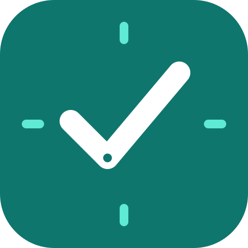
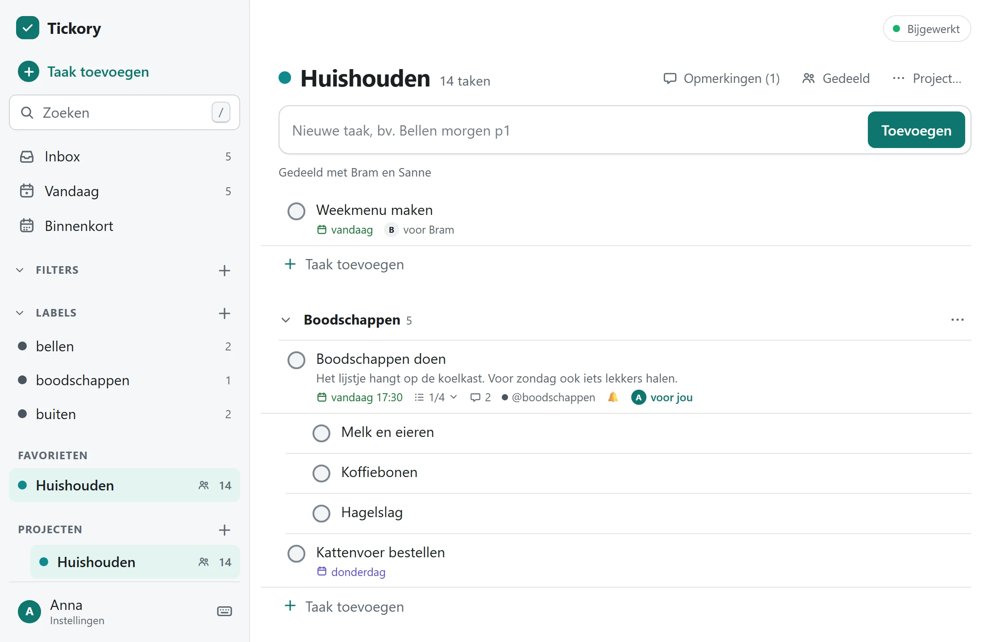

<p align="center">
  
</p>
<h1 align="center">Tickory</h1>
<p align="center">
  De takenlijst die je zelf host: voor jezelf, je gezin of een klein team.<br>
  <a href="https://wnijhof.github.io/tickory/nl/">Website</a> ·
  <a href="https://wnijhof.github.io/tickory/demo/?lang=nl">Demo</a> ·
  <a href="https://wnijhof.github.io/tickory/nl/handleiding/">Handleiding</a> ·
  <a href="README.md">English</a>
</p>

Zelf te hosten, offline-first takenapp voor jezelf, je gezin of een klein team: een sync-server en een installeerbare web-app (PWA) in één Docker-container. Meerdere gebruikers, gedeelde projecten, taken toewijzen, herinneringen met meldingen. De app is er in het Nederlands en het Engels. Het protocol staat in [SPEC.md](SPEC.md); het is een eigen ontwerp, gebouwd op de bevindingen van een eerder onderzoek naar de werking van Todoist (niet onderdeel van deze repo).

Geen npm-pakketten en geen build-stap: Node 26 voert de TypeScript zelf uit en SQLite zit in Node. De image is daardoor klein en heeft vrijwel niets om te onderhouden.

<picture>
  <source media="(prefers-color-scheme: dark)" srcset="website/assets/shots/project-dark.webp">
  
</picture>

## Proberen

De [demo](https://wnijhof.github.io/tickory/demo/?lang=nl) is de echte app met voorbeeldgegevens, helemaal in je browser: geen server, geen account, er wordt niets bewaard. Herinneringen kun je erin uitproberen (het belletje bij een taak, het deel Herinneringen in het venster van een taak, Instellingen, "Herinneringen en meldingen"), maar **meldingen werken niet in de demo**: die komen van een server, dus alleen op je eigen. Dezelfde demo draai je ook lokaal:

```sh
node scripts/build-site.ts && node scripts/serve-site.ts     # http://127.0.0.1:8798/tickory/demo/
```

De uitgebreide [handleiding](https://wnijhof.github.io/tickory/nl/handleiding/) staat op de website, voor gebruikers en voor beheerders.

## Draaien op je home server (Docker)

Je hebt Docker met `docker compose` nodig. De image is er voor `amd64` (gewone pc, mini-pc, NAS) en `arm64` (Raspberry Pi met 64-bit systeem; 32-bit wordt niet ondersteund).

```sh
git clone https://github.com/WNijhof/tickory.git
cd tickory
cp .env.example .env
```

1. **Eerste account.** Zet in `.env` de gebruikersnaam en het wachtwoord (minimaal 10 tekens) van het eerste account, `TODO_ADMIN_USER` en `TODO_ADMIN_PASSWORD`. Dat account wordt bij de allereerste start aangemaakt en is **beheerder**: daarmee maak je daarna in de app de andere accounts aan. Zet `.env` nooit in git (het staat al in `.gitignore`). Haal het wachtwoord na de eerste start uit `.env` **en maak de container opnieuw aan** (`docker compose up -d --force-recreate`): anders blijft het in de configuratie van de container staan, waar `docker inspect` het toont. Wil je het helemaal niet in de omgeving hebben, gebruik dan `TODO_ADMIN_PASSWORD_FILE` (het pad van een bestand met het wachtwoord, bijvoorbeeld een Docker-secret onder `/run/secrets/`). Het wachtwoord mag niet makkelijk te raden zijn (een veelgebruikt woord of wachtwoord, te weinig verschillende tekens).
2. **Image.** `docker-compose.yml` haalt `ghcr.io/wnijhof/tickory:latest` op. Liever zelf bouwen op de server? Haal dan de regel `image:` weg en zet `build: .` terug.
3. **Starten.**

   ```sh
   docker compose up -d
   docker compose ps          # na enkele seconden: (healthy)
   docker compose logs -f
   ```

De container is standaard alleen bereikbaar vanaf de server zelf (`127.0.0.1:8787`). Daarvoor staat er **HTTPS**, zie hieronder. Wil je het alleen op je thuisnetwerk gebruiken en zonder HTTPS (dan werkt alleen de computer-browser, zie de opmerking bij HTTPS), maak er dan `"8787:8787"` van en open `http://<ip-van-de-server>:8787`.

Open de app en log in met het eerste account.

### Accounts en gebruikers

- **In de app:** Instellingen, "Account, wachtwoord en apparaten". Daar wijzig je je wachtwoord en zie je op welke apparaten je bent aangemeld (en meld je er een af). Als beheerder staat daar ook "Gebruikersbeheer": accounts aanmaken, blokkeren, beheerder maken en wachtwoorden herstellen.
- **Vanaf de server**, bijvoorbeeld als je je wachtwoord kwijt bent:

  ```sh
  docker compose exec tickory node server/main.ts user list
  docker compose exec -e TODO_PASSWORD='een-goed-wachtwoord' tickory node server/main.ts user add anna --name "Anna de Vries"
  docker compose exec -it tickory node server/main.ts user passwd anna        # vraagt om het wachtwoord, ongezien
  docker compose exec tickory node server/main.ts user disable anna           # of: enable, logout-all
  ```

  Met `--admin` achter `user add` maak je een beheerder. Zonder `TODO_PASSWORD` en zonder terminal (`-it`) kan er geen wachtwoord worden gevraagd.
- Er is geen open registratie en geen wachtwoordherstel per e-mail: een beheerder maakt accounts aan en herstelt wachtwoorden. Er blijft altijd minstens één actieve beheerder.
- Elk apparaat krijgt bij het inloggen een eigen sessie die je kunt intrekken. Inloggen is per kwartier begrensd: na acht mislukte pogingen op één account vanaf één adres, na veertig vanaf één adres (een IPv6-netwerk telt als één adres) of na zestig op één account in totaal, wordt inloggen geweigerd tot dat kwartier voorbij is. Pogingen worden geteld vóórdat het wachtwoord wordt gecontroleerd, dus een stroom gelijktijdige pogingen komt er niet doorheen. Omdat de teller van het account per adres is, kan een ander je vanaf zijn adres niet buitensluiten van je eigen account. De grenzen staan in `server/limits.ts` en in de SPEC; ook kan elke gebruiker maar een redelijke hoeveelheid opslaan (taken, labels, herinneringen, apparaten).
- Een beheerder beheert accounts, niet andermans taken: ook een beheerder ziet alleen projecten waar die zelf lid van is.

### Delen en samenwerken

- Open een project, kies **Delen**, en typ de gebruikersnaam van iemand anders van deze server. Die persoon ziet het project met alles erin (ook wat er al stond), en iedereen werkt in dezelfde taken, secties en subprojecten. Wie het project maakte is **eigenaar**; de anderen zijn **lid**.
- De eigenaar kan delen, mensen eruit halen, het project verplaatsen en verwijderen. Een lid kan in het project werken en er zelf uit gaan ("Project verlaten"). Een eigenaar kan niet weg zonder het project te verwijderen.
- Taken kun je **toewijzen** aan een lid ("voor Bob"). Verlaat of verdwijnt iemand, dan vervalt de toewijzing.
- Je **Inbox** is van jou alleen en kan niet worden gedeeld.
- **Persoonlijk blijft:** herinneringen, filters en labels. Labels die iemand anders op een taak in een gedeeld project zet, zie je wel (als `@label`), maar je kunt ze niet wijzigen of verwijderen.
- Subprojecten van een gedeeld project worden mee gedeeld. Verwijder je een project, dan blijft een subproject waar je geen eigenaar van bent staan, op het hoogste niveau. (In de app maak je er een met "Subproject toevoegen" in het projectmenu; een project verplaatsen kan nog niet.)
- Bekende beperking: de **volgorde in de zijbalk** en het markeren als favoriet horen bij het project en zijn dus niet per persoon.

### Herinneringen en meldingen

- **Instellen.** In het venster van een taak, het deel Herinneringen: kies "30 minuten vooraf", "1 dag vooraf", "Op het tijdstip van de taak" enzovoort, of kies een datum en tijd. Een herinnering *vooraf* werkt alleen bij een taak met een tijd. Op één regel typ je `!30m` (minuten vooraf), `!1u` (uren), `!2d` (dagen), `!0` (op het tijdstip van de taak) of een zin tussen haakjes voor een vast moment, bijvoorbeeld `!(vandaag om 20:00)`. Een belletje bij een taak betekent dat er een herinnering is.
- **Automatische herinnering.** Elke taak met een tijd krijgt vanzelf een herinnering, standaard 30 minuten vooraf (Instellingen, "Herinneringen en meldingen"; "Geen automatische herinnering" zet dat uit). Daar zie en stel je ook je **tijdzone** in; herinneringen gaan af op die tijd. Herinneringen zijn persoonlijk: in een gedeeld project ziet of krijgt niemand anders de jouwe.
- **In de browser** (Web Push, van de server via de pushdienst van je browser): vraagt HTTPS of `localhost`; op een iPhone of iPad alleen voor een app op het beginscherm. Zet het per apparaat aan onder Instellingen, "Herinneringen en meldingen", "Meldingen aanzetten", en controleer het met "Testmelding versturen". De melding heeft de knoppen Voltooien en Over 10 minuten. De server kijkt elke 20 seconden; een herinnering die hooguit een uur te laat is, wordt nog verstuurd, een oudere vervalt.
- **Op de server:** er is niets te installeren. De server maakt zelf sleutels voor de meldingen (VAPID) en bewaart ze in de database, dus een back-up bevat ze. Optioneel in `.env`: `VAPID_SUBJECT` (jouw contactadres, `mailto:jij@voorbeeld.nl` of een https-adres; de pushdienst van Apple vraagt erom) en `DEFAULT_TIMEZONE` (voor gebruikers die nog geen tijdzone hebben ingesteld; `Europe/Amsterdam`). De server zelf moet via https bij de pushdiensten van Google, Mozilla, Microsoft en Apple kunnen komen.
- **Het werkt niet?** Zie [Meldingen komen niet aan](https://wnijhof.github.io/tickory/nl/handleiding/problemen-oplossen.html#meldingen-komen-niet-aan). De meldingen in de browser zijn getest met een nagebootste pushdienst; of er een bij jou aankomt, hangt af van je browser, besturingssysteem en hun pushdienst.

Meer in de handleiding: [Herinneringen](https://wnijhof.github.io/tickory/nl/handleiding/herinneringen.html).

### De Android-app

Een eigen app (Kotlin, in [`android/`](android/README.md)) die de web-app van je server toont en je herinneringen als **alarmen op de telefoon zelf** inplant, zodat ze ook afgaan als de app dicht is en zonder internet. Geen Google-diensten, geen Firebase, geen trackers; de app praat alleen met de server die je invult.

- **Er is nog geen release.** De eerste APK komt met de eerstvolgende versie, als bijlage bij die versie op de [releasepagina](https://github.com/WNijhof/tickory/releases). Tot die tijd gebruik je de web-app in de browser van je telefoon, of bouw je de app zelf: zie [android/README.md](android/README.md) (JDK 21 en de Android SDK).
- **Installeren** (als er een APK is): download hem op de telefoon, open hem en sta "onbekende apps installeren" toe voor de app waarmee je hem opent, vul dan het adres van je server in en log in. Bijwerken: installeer de nieuwe APK over de oude heen; dat kan alleen als beide met dezelfde sleutel zijn ondertekend (een debug-APK kan niet bijwerken, verwijder die eerst).
- **Beperkingen:** zonder verbinding openen werkt alleen als je server op `https` staat (de herinneringen gaan wel af); de app vertrouwt alleen certificaten die Android zelf vertrouwt, geen zelfgemaakte; een inlogpagina vóór de server (Authelia, Cloudflare Access) werkt niet; er is geen bestandskiezer (bijlagen bestaan nog niet). Android 8 of nieuwer.
- **Niet op een telefoon getest.** De app is getest op een computer (rekenregels, een nagebootste Android en één test tegen een echte server), maar de maker heeft hem nog niet op een echt toestel geprobeerd. Meld gerust wat je tegenkomt.
- **Widgets (volgende versie).** Vier widgets voor het startscherm: **Vandaag** (te laat en vandaag), **Project of lijst** (je kiest bij het plaatsen de Inbox, een project, Vandaag of Binnenkort; opgeslagen filters komen later), **Binnenkort** (de komende twee weken, per dag) en een knop **Taak toevoegen**. Tik op de cirkel om af te vinken, ook zonder internet (de taak wacht in een wachtrij op de telefoon en gaat mee zodra er verbinding is; een terugkerende taak komt terug met de nieuwe datum van de server), tik op de titel om de taak te openen, tik op + om er een toe te voegen. Formaat aanpasbaar, licht en donker, Material You-kleuren op Android 12 en nieuwer, beschrijvingen voor TalkBack, Nederlands en Engels. Ze lezen de gegevens op het toestel, niet de ingebouwde browser; afmelden of van account wisselen wist alles. Nog niet op een telefoon geprobeerd: het uiterlijk per launcher, het formaat aanpassen en stroombesparing. Zie [de handleiding](https://wnijhof.github.io/tickory/nl/handleiding/widgets.html) en [android/README.md](android/README.md).

Meer in de handleiding: [de Android-app](https://wnijhof.github.io/tickory/nl/handleiding/android-app.html).

### Upgraden vanaf versie 0.1

Versie 0.1 had één token voor één persoon. Zet in `.env` `TODO_ADMIN_USER` en `TODO_ADMIN_PASSWORD` (je mag `TODO_TOKEN` weghalen), en start de nieuwe versie. Bij de eerste start wordt dat account aangemaakt en **neemt het alle bestaande gegevens over** (projecten, labels, filters, herinneringen), inclusief je Inbox. Daarna moet je op elk apparaat opnieuw inloggen. Maak vooraf een back-up (zie hieronder).

### HTTPS (nodig voor je telefoon)

Browsers staan **offline gebruik** (service worker), **installeren als app** en **meldingen in de browser** alleen toe via HTTPS; alleen `localhost` is een uitzondering. Zonder HTTPS werkt de app op je telefoon dus wel in de browser, maar niet offline, niet als geïnstalleerde app en zonder meldingen (de Android-app heeft voor haar alarmen geen HTTPS nodig). Kies wat bij je netwerk past:

- **Tailscale** (het eenvoudigst, niets openbaar): installeer Tailscale op server en telefoon, schakel HTTPS in je tailnet in en draai op de server `tailscale serve --bg 8787`. Je krijgt een `https://…ts.net`-adres dat alleen je eigen apparaten bereiken.
- **Reverse proxy met een eigen domein** (Caddy, Traefik, Nginx Proxy Manager): laat de proxy naar `127.0.0.1:8787` wijzen en het certificaat regelen. Met Caddy is de hele configuratie:

  ```
  taken.voorbeeld.nl {
      reverse_proxy 127.0.0.1:8787
  }
  ```

  Zet daarbij in `.env` `TRUST_PROXY=1`, zodat het adres van de bezoeker (en niet dat van de proxy) telt bij het beperken van inlogpogingen. Zet dit **alleen** aan als er echt een proxy voor staat: anders kan een bezoeker zijn eigen adres opgeven.
- **Cloudflare Tunnel**: handig als je geen poorten wilt openzetten.

Zet de app niet zonder HTTPS op het open internet: wachtwoord en sessie reizen dan onversleuteld.

### Bijwerken

Zet je als beheerder een nieuwe versie-tag (zie hieronder), dan bouwt GitHub een nieuwe image. Op de server:

```sh
docker compose pull && docker compose up -d
```

Je gegevens staan in een Docker-volume en blijven behouden. Bouw je zelf: `git pull && docker compose up -d --build --pull always`. Let op: een nieuwe versie van de onderliggende Node-image (beveiligingsupdates) komt pas binnen als er een nieuwe image wordt gebouwd.

### Back-up en terugzetten

De database is één SQLite-bestand in het volume. Maak een consistente kopie terwijl de app draait:

```sh
docker compose exec -T tickory node server/backup.ts /data/backups/todo-$(date +%F).db
```

Dit overschrijft nooit een bestaande kopie. De kopieën staan in het volume zelf; haal ze regelmatig ook van de server af, bijvoorbeeld met `docker cp tickory:/data/backups ./backups`, en plan het commando in met `cron`. Oude kopieën ruim je zelf op. **Een kopie bevat alle taken van alle gebruikers, de wachtwoord-hashes, de (gehashte) sessies en de sleutels van de server voor meldingen (de VAPID-privésleutel en het geheim dat de knoppen in een melding ondertekent)**: wie hem heeft, kan bewijzen voor die knoppen maken voor elke taak van elke gebruiker. Bewaar hem zoals je de database zelf bewaart, en houd ook de map met kopieën dicht voor anderen.

Terugzetten van een kopie (de app moet stilstaan; vervang `backup.db` door je bestand):

```sh
docker compose down
docker run --rm -v tickory_tickory-data:/data -v "$PWD":/backup alpine sh -c \
  "rm -f /data/todo.db-wal /data/todo.db-shm && cp /backup/backup.db /data/todo.db && chown 1000:1000 /data/todo.db"
docker compose up -d
```

De volumenaam begint met de naam van de map waarin je `docker compose` draait (hier `tickory`); controleer hem met `docker volume ls`. **Meld daarna op elk apparaat af en weer aan** (Instellingen, "Afmelden en lokale gegevens wissen"). Een apparaat dat nog nieuwere wijzigingen kende dan de back-up merkt het teruggezette bestand alleen vanzelf op zolang de server nog niet voorbij zijn stand is gegroeid; opnieuw aanmelden is de zekere weg en kost niets, omdat alles op de server staat.

### Privé image

De repo is openbaar. Een pakket op ghcr.io begint bij de eerste publicatie als privé en de eigenaar moet het eenmalig openbaar maken (GitHub: je profiel, Packages, `tickory`, Package settings, Change visibility). Tot die tijd moet een server eenmalig inloggen om het te kunnen ophalen:

```sh
docker login ghcr.io -u <jouw-github-naam>     # wachtwoord: een token met alleen "read:packages"
```

Is het pakket openbaar, dan is inloggen niet nodig. Er staat niets geheims in de image (wachtwoorden en accounts zitten alleen in je eigen `.env` en database).

## Een nieuwe versie publiceren (beheerder)

```sh
git tag v0.2.0 && git push origin v0.2.0
```

De workflow `Image publiceren` draait de tests, bouwt de image, **start hem met de beveiligingsinstellingen uit `docker-compose.yml` en controleert zijn gedrag** (gezond, juiste gebruiker, alleen `/data` beschrijfbaar, het eerste account en een tweede account, gescheiden gegevens, gegevens overleven een herstart, netjes stoppen, back-up werkt), en publiceert daarna `ghcr.io/WNijhof/tickory` met de tags `0.2.0`, `0.2` en `latest`. Slaagt één controle niet, dan wordt er niets gepubliceerd.

## Snel toevoegen

Typ één regel in het invoerveld; onder het veld zie je wat er herkend is.

```
Tandarts bellen morgen om 9 uur #Thuis /Keuken @bellen p1
Oud papier elke tweede dinsdag
Verjaardag Jan elk jaar op 5 december
Cadeau kopen voor Sinterklaas
Belasting regelen eind januari
Hardlopen elke ochtend om 7 uur
Aangifte doen {31-12} !!2
Tandarts bellen morgen om 9 uur !1u !(vandaag om 20:00)       (herinneringen: 1 uur vooraf, en vanavond om 20:00)
~Mei bellen          (het ~ zet de datumherkenning voor de hele regel uit)
```

`#project`, `/sectie` (binnen dat project), `@label` (onbekende labels worden aangemaakt), `p1` tot `p4` of `!!1` tot `!!4` (1 is de hoogste), `{deadline}`, `!30m` `!1u` `!2d` `!0` `!(…)` voor herinneringen (zie hierboven), en een datum of herhaling in gewone taal.

## Nederlands

Nederlands is de hoofdtaal van de app. De interface en de meldingen zijn er in het Nederlands en het Engels (de app volgt je browser, en onder Instellingen, "Taal / Language" kies je zelf); de **datumtaal**, wat je intypt, is voorlopig alleen Nederlands. Engelse zinnen als `tomorrow` worden nog niet herkend, en de app zegt dat als je er een typt. Wat in elke taal werkt: `31-12` en `31-12-2026`, en in het datumveld van een taak `2026-12-31` en `2026-12-31T14:30`. Wat werkt:

- **Datums:** `morgen`, `overmorgen`, `vanavond`, `volgende week donderdag`, `aanstaande vrijdag`, `over twee weken`, `eind van de week`, `deze week` (= vrijdag), `25 december`, `3 maart 2027`, `begin december`, `midden mei`, `eind januari`, en tijden als `om 9 uur`, `om half 3`, `kwart over 2`, `14u30`, `2 uur 's middags`, `over een kwartier`.
- **Herhalingen:** `elke dag`, `elke maandag`, `elke ma en do`, `elke werkdag`, `doordeweeks`, `elke 2 weken`, `om de week`, `elke ochtend/middag/avond` (met een standaardtijd van 9, 15 en 20 uur, tenzij je er een tijd bij zet), `elke maand op de 15e`, `elke laatste dag van de maand`, `elk jaar op 5 december`, en de **n-de weekdag van de maand**: `elke eerste maandag`, `elke tweede dinsdag`, `elke laatste vrijdag` (eerste tot en met vierde, en laatste).
- **Feestdagen**, met een voorzetsel (`voor`, `tegen`, `op`, `uiterlijk`, `per`): Kerst en de eerste en tweede kerstdag, Oud en nieuw, Nieuwjaar, Sinterklaas en pakjesavond, Koningsdag, Bevrijdingsdag, Dodenherdenking, Goede Vrijdag, Pasen en tweede paasdag, Hemelvaart, Pinksteren en tweede pinksterdag. De datum van Pasen wordt voor elk jaar berekend.
- **Letters:** `é`, `ë`, `ï`, `ö` en dergelijke werken overal, hoofdletterongevoelig (`@ÉÉN` is het label `één`) en ook als een toetsenbord ze als losse tekens aflevert. Alle tekst wordt in dezelfde Unicode-vorm (NFC) bewaard, ook gebruikersnamen en wachtwoorden. Na het weghalen van een datum wordt `ijs` correct `IJs` (in het Nederlands is IJ één letter).
- **Meldingen** als de server een wijziging weigert, zijn begrijpelijk, met wat je probeerde te doen (ook in de Engelse interface).

Bewust niet aangeraakt, om geen verkeerde datum te raden: een titel met **twee** datums, een feestdag zonder voorzetsel (`Kerst inkopen doen` blijft een gewone taak), `Mei bellen`, `Zo snel mogelijk`, `Hoofdstuk 3`. Typ `~` voor een woord om de herkenning daar uit te zetten. Niet ondersteund: `elke vijfde dinsdag` (een vijfde bestaat niet altijd; gebruik `elke laatste dinsdag`) en `elke tweede week van de maand`.

Goed om te weten: een heel uur van 1 tot en met 7 zonder dagdeel wordt als middag of avond gelezen (`om 7 uur` is 19:00); typ `om 07:00` of `7 uur 's ochtends` voor de vroege ochtend. Alle vormen, met voorbeelden die tegen de herkenner zelf zijn nagerekend, staan in de handleiding: [datums en herhalingen](https://wnijhof.github.io/tickory/nl/handleiding/datums-en-herhalingen.html).

## Lokaal draaien zonder Docker

Vereist Node 26. Handig om te proberen of te ontwikkelen.

```sh
TODO_ADMIN_USER=anna TODO_ADMIN_PASSWORD='een-goed-wachtwoord' node server/main.ts      # bash; http://127.0.0.1:8787
```

Op Windows: dubbelklik op `start.cmd`, of draai `.\start.cmd` in PowerShell. Bij de eerste keer vraagt dat om een gebruikersnaam en een wachtwoord (ongezien getypt) voor het eerste account, en daarna start de server; het scriptbeleid van Windows blijft ongewijzigd (zie `start.cmd`).

Omgevingsvariabelen: `TODO_ADMIN_USER`, `TODO_ADMIN_PASSWORD` (of `TODO_ADMIN_PASSWORD_FILE`, het pad van een bestand met het wachtwoord) en `TODO_ADMIN_NAME` (alleen bij de allereerste start), `PORT` (8787), `HOST` (127.0.0.1; in Docker 0.0.0.0), `DB_PATH` (`./data/todo.db`; in Docker `/data/todo.db`), `TRUST_PROXY` (`1` achter een eigen reverse proxy), `CORS_ORIGIN` (optioneel, één exacte oorsprong), `VAPID_SUBJECT` (contactadres voor meldingen, optioneel) en `DEFAULT_TIMEZONE` (`Europe/Amsterdam`). Zie `.env.example`.

## Testen

```sh
npm test            # protocol, rechten, accounts, server, client, datumtaal, herinneringen en meldingen, filters en zoeken, talen, overzichten, back-up, offline-bestanden
npm run e2e         # de hele app in een echte browser (Edge of Chrome, zonder venster), 37 stappen
node scripts/docker-smoke.ts tickory:ci    # test van de image (vereist Docker, na: docker build -t tickory:ci .)
node scripts/build-site.ts && node scripts/site-check.ts    # de website en de demo (vereist Edge of Chrome)
```

De tests omvatten onder meer een eigenschappentest voor de volgordesleutels en een **differentiële test**: honderden willekeurige handelingen worden zowel optimistisch in de client als door de echte server-engine uitgevoerd, en beide moeten op exact dezelfde toestand uitkomen. Voor meerdere gebruikers zijn er aparte tests van wie wat mag zien en doen (twee echte clients op één server), en de toegangsregels zijn gecontroleerd met opzettelijk gebroken code: elke gebroken regel moet een test laten falen. Ze slagen in elke tijdzone. De browsertest legt schermafbeeldingen vast in `.e2e/shots/`.

## De website

De website (startpagina, handleiding en demo) is gewone HTML, CSS en JavaScript in `website/`, gebouwd zonder afhankelijkheden:

```sh
node scripts/build-site.ts      # bouwt _site/: de pagina's, en demo/ met de app en een backend in de browser
node scripts/serve-site.ts      # serveert het op http://127.0.0.1:8798/tickory/, hetzelfde pad als op GitHub Pages
node scripts/site-check.ts      # controleert links, de datumvoorbeelden uit de handleiding, en de demo in een browser zonder venster
node scripts/site-shots.ts      # maakt de schermafbeeldingen en het voorbeeldplaatje opnieuw, vanuit de demo
node scripts/make-icons.js      # tekent de PNG-pictogrammen opnieuw, met dezelfde maten als client/icon.svg
```

- Een pagina is een stuk HTML in `website/pages/nl/` of `website/pages/en/`; het menu en de vaste teksten staan in `website/site.json`, de opmaak in `website/layout.html`. Elke Nederlandse pagina heeft een Engelse tegenhanger met dezelfde opbouw; de controle bewaakt dat.
- De demo is de echte app waarin alleen `client/core/backend.js` is vervangen door `website/demo/backend.js`: een "server in de browser" met voorbeeldgegevens (`website/demo/seed.js`). De controle vergelijkt die met de echte server.
- De workflow `Website` (`.github/workflows/pages.yml`) bouwt, controleert en publiceert de site op GitHub Pages bij elke push naar `main`. Zet daarvoor eenmalig in de repo Settings, Pages, Source op "GitHub Actions".

## Indeling

```
shared/    orderKey.js, recurrence.js, reminders.js, schema.js, text.js   gedeeld door server en client
server/    schema.ts, rows.ts, sync.ts, users.ts, push.ts, webpush.ts, main.ts, backup.ts
           tabellen, rijen, sync-engine met rechten, accounts en sessies, meldingen (Web Push), HTTP + SSE + bestanden, back-up
client/    index.html, app.css, sw.js, manifest             de web-app
client/core/   reducer, store, idb, syncClient, events, actions, auth, backend, i18n, dateNl, quickadd, quickDates, rowModel, colors, commentText, timeAgo, shortcuts, reminderText, push, filter, search, selectors, format, messages
client/ui/     app, render, taskDialog, projectDialog, quickAdd, comments, miscDialogs, reminderUi, shareDialog, accountDialogs, icons, dom
client/i18n/   nl.js, en.js                                  de teksten van de interface, in het Nederlands en het Engels
android/       de Android-app (Kotlin, WebView, lokale alarmen)
client/vendor/ nlDatum.generated.js                         Nederlandse datumherkenner (met chrono-node, zie THIRD_PARTY_NOTICES.md)
website/       pages (nl, en), assets, layout.html, site.json, demo/   de website, de handleiding en de backend van de demo
scripts/       e2e.ts, docker-smoke.ts, smoke.ts, make-icons.js, start.ps1,
               build-site.ts, serve-site.ts, site-check.ts, site-shots.ts, site-browser.ts
```

## Status

Versie 0.2: meerdere gebruikers, gedeelde projecten, herinneringen met meldingen en een interface in het Nederlands en het Engels. De kern werkt en is getest; veel functies uit apps als Todoist ontbreken nog.

**Wat de app kan:** meerdere accounts met een eigen Inbox, projecten delen met anderen en taken toewijzen, taken met subtaken, projecten met een kleur, subprojecten, favorieten en archiveren, secties, labels (via snel toevoegen en het taakvenster), **opmerkingen** bij taken en projecten, prioriteiten P1 tot P4, datum en tijd, deadlines, herhalingen, **herinneringen** (meer per taak, relatief of op een vast tijdstip, een automatische herinnering, een eigen tijdzone) met **meldingen** in de browser (Web Push, vraagt HTTPS) en als alarm in de Android-app, de interface in het Nederlands en het Engels, een zijbalk met Inbox, Vandaag, Binnenkort, favorieten en projecten, een taakvenster met alle details, sneltoetsen (`q`, `g` dan `t`, `u` of `i`, `?`), voltooide taken tonen of verbergen, afvinken met ongedaan maken, offline werken met synchronisatie, meerdere apparaten tegelijk, installeren als app, en apparaten en wachtwoorden beheren.

**Komt eraan (gebouwd of half gebouwd, nog niet te gebruiken):**
- **De eerste Android-APK.** De app bestaat en is op een computer getest, maar er is nog geen release en de maker heeft hem niet op een echte telefoon geprobeerd. De eerste APK komt met de eerstvolgende versie, en daarmee ook de **widgets voor het startscherm** (zie hieronder); tot die tijd gebruik je de web-app in de browser van je telefoon, of bouw je hem zelf (zie [android/README.md](android/README.md)).
- **Filters en zoeken.** De logica zit in de code (een filtertaal in het Nederlands en het Engels, en zoeken in taken, projecten, secties, labels en filters), maar de app heeft er geen scherm, zoekveld of knop voor. Je kunt het dus nog niet gebruiken.
- **Engelse datumtaal.** De interface is Engels, maar wat je als datum intypt, wordt alleen in het Nederlands herkend.

**Staat wel op de server, maar de app heeft er nog geen scherm of knop voor** (je kunt het dus niet gebruiken):
- De **duur** van een taak, en bord- of kalenderweergave.

**Ontbreekt helemaal:**
- **Slepen of anderszins de volgorde van taken wijzigen.** Een nieuwe taak komt altijd achteraan.
- **Labels beheren** (hernoemen, verwijderen, op een label filteren) in de app.
- Bijlagen, statistieken, sjablonen, import en export, een iCal-feed, widgets, een eigen volgorde voor Vandaag, uitnodigen via een link of e-mail, en overdragen van de eigenaar van een project.

Wat erbij komt en in welke volgorde, bepaalt de eigenaar van de repo. SPEC.md hoofdstuk 10 is ouder dan deze lijst en niet bijgewerkt; deze lijst klopt.

## Bijdragen en beveiliging

Zie [CONTRIBUTING.md](CONTRIBUTING.md) voor hoe je test en wat de uitgangspunten zijn (zero dependencies, Nederlands als hoofdtaal, tests die echt kunnen falen). Een kwetsbaarheid meld je niet openbaar; zie [SECURITY.md](SECURITY.md).

## Licentie

Tickory is vrije software onder de [GNU Affero General Public License, versie 3](LICENSE) (AGPL-3.0). Je mag het gebruiken, aanpassen en verspreiden; wie een aangepaste versie als dienst aan anderen aanbiedt, moet de broncode daarvan beschikbaar stellen. Voor de meegebundelde datumherkenning geldt de MIT-licentie van chrono-node, zie [THIRD_PARTY_NOTICES.md](THIRD_PARTY_NOTICES.md).
